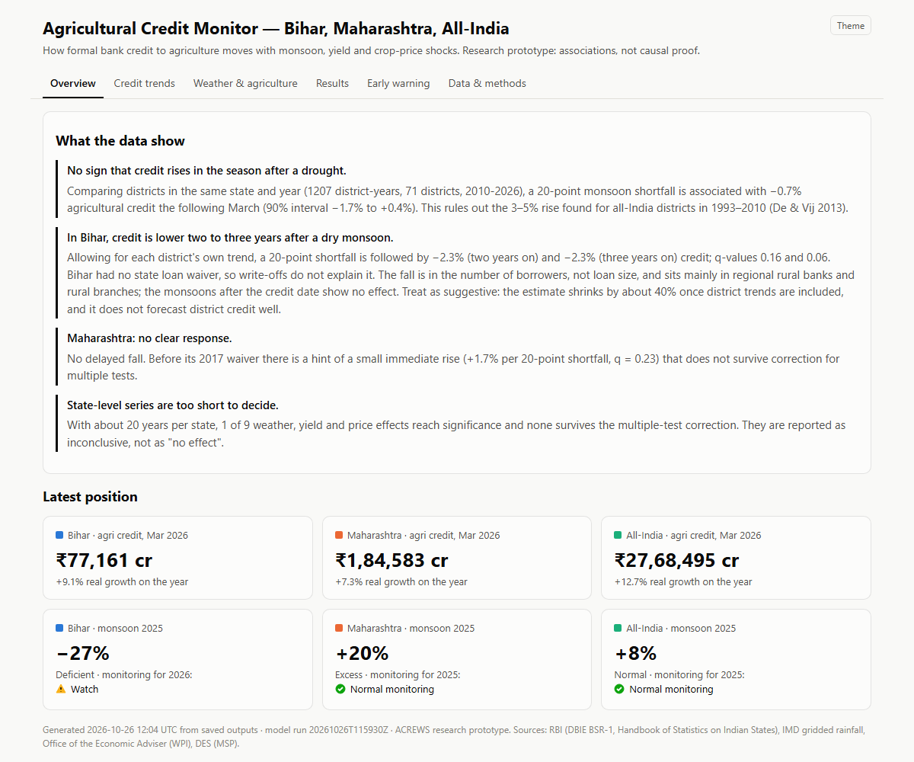
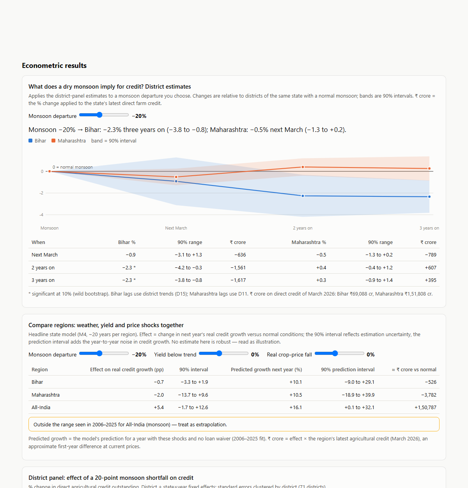
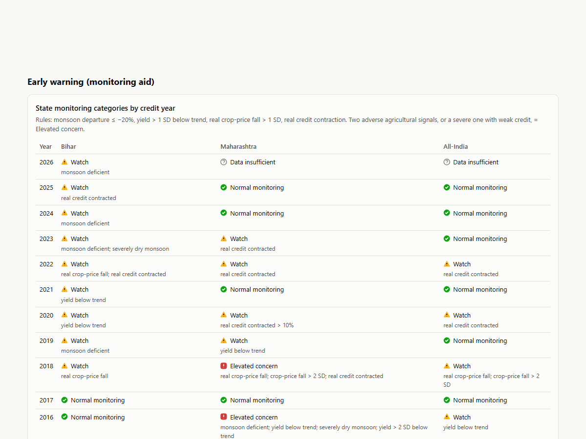

# ACREWS dashboard — user guide

**Open** `app/dashboard.html` in any browser (Chrome, Edge, Firefox; phone or desktop). It is one offline file: no install, no internet. Rebuild it after new data with `.venv\Scripts\python.exe src\run_pipeline.py --skip-ingestion`.

**Read every number as an association with a 90% range, not a forecast.** None of the models beats a naive "credit grows at its average" forecast out of sample.

## The six tabs

| Tab | What it answers |
|---|---|
| Overview | The four findings in plain words, and the latest credit and monsoon for each region |
| Credit trends | Agricultural credit since 2004 (₹ crore and real growth), loan-waiver years shaded |
| Weather & agriculture | Monsoon departure since 1990, foodgrain yield shortfall, real crop-price fall |
| Results | The two scenario tools, every model estimate, the event study, the mechanism split and all validation checks |
| Early warning | Monitoring category per region and year, the district watch list, and its (weak) backtest |
| Data & methods | Sources, data checks, definitions and limitations |

Every chart has **Show table** and **Download CSV** under it. Hover a point (or tap on a phone) for its exact value.

## Scenario tools (Results tab)

**1. District estimates — "What does a dry monsoon imply for credit?"** Move the monsoon slider. The chart shows credit in Bihar and Maharashtra relative to a normal monsoon in the March after it and two and three years later, with a 90% band. The table gives the same in % and ₹ crore of today's direct farm credit; `*` marks estimates significant at 10%.

**2. State model — "Compare regions".** Set monsoon departure, yield shortfall and real crop-price fall together. Each region gets the effect on next year's real credit growth (90% interval) and a predicted growth rate with a wider 90% prediction interval that includes year-to-year noise. A yellow box appears when an input lies outside what that region saw in 2006–2025.

### Worked examples

| Scenario | Tool | Result | How to read it |
|---|---|---|---|
| Monsoon −30% | District | Bihar: −1.4% next March (−4.7 to +1.9), then −3.4% two years on (−6.3 to −0.5) and −3.5% three years on (−5.7 to −1.3), about ₹2,400 crore | Only the lagged Bihar fall is significant; it reflects fewer borrowers at regional rural banks |
| Monsoon −30% | District | Maharashtra: −0.8% next March (−1.9 to +0.4), no later fall | Inconclusive throughout |
| Monsoon −15%, yield 10% below trend, prices −5% | State model | Bihar −6.8 pp real credit growth (−12.2 to −1.4); Maharashtra +3.5 (−3.8 to +10.7); All-India +3.8 (−7.3 to +14.9), flagged as outside All-India's yield range | Bihar's in-sample combination looks procyclical, mostly through prices, but no single shock survives the multiple-testing correction |

## Early warning tab

Categories are rules, not predictions: **Watch** when one adverse signal fires (deficient monsoon, yield more than 1 SD below trend, real price fall more than 1 SD, credit contraction), **Elevated concern** when two agricultural signals fire, **Data insufficient** when inputs are missing. Hover a cell to see which indicators fired. The district list adds Bihar districts with a deficient monsoon one to two years earlier, the lag found in the results.

## Limits to keep in mind

- Credit is a stock: new loans, renewals and write-offs are mixed.
- Crop prices are national, so the two states differ only through crop mix.
- About 20 years per state: wide intervals are honest, not a bug.
- Scenarios outside the historical range are flagged and should not be trusted.
